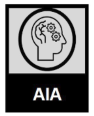

# Unit 3: E-CARGO Multi-Robot Swarm Orchestration

Welcome to **Unit 3** of **COSC 3657 (Distributed Systems)**. In this capstone group project, you take on the role of a **System Architect** to orchestrate an adaptive, heterogeneous multi-robot swarm on Kubernetes.

Unlike Unit 2—where a controller maintained identical, stateless pod replicas—autonomous robotic fleets consist of **necessarily spread, heterogeneous nodes** that share no physical memory and coordinate **only by passing messages**. Using Dr. Haibin Zhu’s **E-CARGO** (*Environments, Classes, Agents, Roles, Groups, and Objects*) framework and simplified **Group Role Assignment (GRA)** linear optimization, your control plane continuously evaluates live hardware telemetry and dynamically reassigns pod roles (`ecargo.role`) to survive battery depletion, sensor failures, wireless signal decay, and sudden workload spikes. 

> **What Is Provided vs. What Your Group Builds:**  
> All infrastructure, Kubernetes manifests, telemetry structures, the PuLP Integer Linear Programming (ILP) solver, and the Kubernetes pod-patching orchestrator are **pre-built and provided** in this repository. Your group is responsible for implementing **only your assigned scenario module** (`scenarios/group_scenario.py`), delivering a **live cluster demo**, and producing **Architectural and Fundamental System Models (with diagrams and illustrations)** grounded in **CDK5 Chapter 2**.

---

## 📚 Textbook Theoretical Alignment (CDK5 Mapping)

This project translates core concepts from *Distributed Systems: Concepts and Design, 5th Edition* (Coulouris, Dollimore, Kindberg, & Blair — **CDK5**) into a cyber-physical orchestration architecture:

| System Component | Distributed Systems Concept | CDK5 Reference | Status |
| :--- | :--- | :--- | :--- |
| **Swarm Pod Manifests (`manifests/swarm_fleet.yaml`)** | Message-Passing Coordination, Heterogeneity, Necessarily Spread Mobile Nodes, Physical Models | **CDK5 Ch. 1.1, 1.5 & 2.2** | Provided |
| **Telemetry Bus (`core/telemetry_bus.py`)** | Indirect Communication, Space/Time Decoupling, Consistent Global State Snapshots | **CDK5 Ch. 6 & 14** | Provided |
| **E-CARGO GRA Solver (`core/ecargo_gra_solver.py`)** | Generalized Coordinator/Role Election, Mathematical System Modeling | **CDK5 Ch. 2.1 & 15** | Provided |
| **Swarm Orchestrator (`core/swarm_orchestrator.py`)** | Adaptive Middleware, Mobility & Reconfiguration Transparency | **CDK5 Ch. 1.5 & 21** | Provided |
| **Group Scenario (`scenarios/group_scenario.py`)** | Adaptivity and Reconfiguration (Interaction, Failure, Security), QoS & Scalability | **CDK5 Ch. 1.5, 2.3 & 2.4** | **Group TODO** |
| **NA** | Architectural & Fundamental Models (Interaction, Failure, Security) | **CDK5 Ch. 1.5, 2.3 & 2.4** | **Group TODO** |

---

## 📁 Repository Structure

```text
unit3-ecargo-swarm/
├── manifests/
│   └── swarm_fleet.yaml           # [PROVIDED] 4 heterogeneous robot pods (robot-a0 to robot-a3)
├── core/
│   ├── __init__.py                # [PROVIDED] Package initializer
│   ├── telemetry_bus.py           # [PROVIDED] AgentTelemetry schema & baseline state generator
│   ├── ecargo_gra_solver.py       # [PROVIDED] PuLP ILP solver for Group Role Assignment
│   └── swarm_orchestrator.py      # [PROVIDED] K8s API client & live pod label patcher
├── scenarios/
│   ├── __init__.py                # [PROVIDED] Package initializer
│   └── group_scenario.py          # [GROUP TODO] Your group's Q-matrix, L-bounds, & event trigger
├── docs/
│   └── system_models.md           # [GROUP TODO] Architectural & Fundamental Models + Diagrams
├── run_demo.py                    # [PROVIDED] Two-phase demo runner (Baseline -> Group Event)
└── requirements.txt               # [PROVIDED] Library list for python runner
└── README.md                      # Project documentation & deliverables checklist
```

---

## 🏗️ System Architecture & E-CARGO Formulation

### Closed-Loop Swarm Control Plane

```text
+-----------------------------------------------------------------------------------+
|                        UNIT 3 CLOSED-LOOP SWARM ARCHITECTURE                      |
+-----------------------------------------------------------------------------------+
|                                                                                   |
|  [Robot Pod a0]   [Robot Pod a1]   [Robot Pod a2]   [Robot Pod a3]                |
|   (Battery/LiDAR)  (Payload/Sonar)  (RSSI/Spatial)   (Standby Node)               |
|         |                |                |                |                      |
|         +----------------+----------------+----------------+                      |
|                                  |  (1) Asynchronous Telemetry (Indirect Comm)    |
|                                  v                                                |
|                   +-----------------------------+                                 |
|                   |   core/telemetry_bus.py     |  <-- (External Job Queue Burst) |
|                   +-----------------------------+                                 |
|                                  |  (2) Qualification Matrix Q & Role Limits L    |
|                                  v                                                |
|                   +-----------------------------+                                 |
|                   | scenarios/group_scenario.py |  <-- [YOUR GROUP'S CODE]        |
|                   +-----------------------------+                                 |
|                                  |  (3) Optimal Assignment Matrix X               |
|                                  v                                                |
|                   +-----------------------------+                                 |
|                   | core/ecargo_gra_solver.py   |  Maximize sum(Q[i,j] * X[i,j])  |
|                   | core/swarm_orchestrator.py  |  Patches K8s Pod Labels Live    |
|                   +-----------------------------+                                 |
+-----------------------------------------------------------------------------------+
```

### E-CARGO Group Role Assignment (GRA) Optimization

The provided solver (`core/ecargo_gra_solver.py`) solves an Integer Linear Program over $m = 4$ robot agents (`robot-a0` through `robot-a3`) and $n = 6$ operational roles (`lead-scout`, `precision-mapper`, `cargo-carrier`, `signal-relay`, `charging`, `standby`).

---

## 🧩 Group Assignment Tracks (1 Scenario per Group)

Each group is assigned **one** operational track below. You must implement your track inside `scenarios/group_scenario.py` without hardcoding agent-to-role assignments.

| Track | Scenario Name | Injected Event (`inject_scenario_event`) | Expected Kubernetes Pod Transitions |
| :--- | :--- | :--- | :--- |
| **Track 1** | **Critical Energy Evacuation & Handoff** | `robot-a0` battery drops to `12.0%` (below the `20.0%` safety cutoff). | `robot-a0`: `lead-scout` $\rightarrow$ `charging`<br>`robot-a3`: `standby` $\rightarrow$ `lead-scout` |
| **Track 2** | **Sensor Failure & Functional Pivot** | `robot-a1` LiDAR fails (`lidar_ok = False`), while drivetrain and payload (`0.85`) remain intact. | `robot-a1`: `precision-mapper` $\rightarrow$ `cargo-carrier`<br>`robot-a2`: `cargo-carrier` $\rightarrow$ `precision-mapper` |
| **Track 3** | **Communication Decay & Mesh Relay** | `robot-a0` advances to `120.0m` (`rssi_dbm = -91.0 dBm`, below `-85.0 dBm`); `robot-a1` is at `60.0m` midpoint. | `signal-relay` activates ($L_{\min}=1$)<br>`robot-a1` $\rightarrow$ `signal-relay`<br>`robot-a3` (`standby`) $\rightarrow$ `precision-mapper` |
| **Track 4** | **Flash Demand Spike & Capacity Scaling** | Pending cargo job queue surges from `1` to `4` urgent tasks. | `L_min[cargo-carrier]` scales from `1` to `2`<br>`robot-a3`: `standby` $\rightarrow$ `cargo-carrier` |

### Student Implementation Interface (`scenarios/group_scenario.py`)

This is the **only code file** your group modifies:

```python
# scenarios/group_scenario.py
import math
import numpy as np
from typing import Dict, Tuple, List
from core.telemetry_bus import AGENTS, ROLES, AgentTelemetry, get_baseline_state

SCENARIO_NAME = "Track X: <Replace with Your Assigned Track Name>"

def inject_scenario_event() -> Tuple[Dict[str, AgentTelemetry], int]:
    """
    Simulate your group's assigned environmental disruption or workload spike.
    """
    telemetry, pending_jobs = get_baseline_state()

    # TODO (Group Implementation): Modify telemetry or pending_jobs for your assigned track
    return telemetry, pending_jobs

def compute_q_and_bounds(
    telemetry: Dict[str, AgentTelemetry],
    pending_jobs: int
) -> Tuple[np.ndarray, List[int], List[int]]:
    """
    Compute the 4x6 Qualification Matrix Q and role capacity vectors (L_min, L_max).
    Must produce valid optimal assignments for both Phase 1 (Baseline) and Phase 2 (Disrupted).
    Roles index order:
      0: lead-scout | 1: precision-mapper | 2: cargo-carrier
      3: signal-relay | 4: charging | 5: standby
    """
    m, n = len(AGENTS), len(ROLES)
    Q = np.zeros((m, n))

    # This part has been populated for each track in this assignment so no longer a TODO item.
    # TODO (Group Implementation):
    # 1. Populate Q[i, j] in [0.0, 1.0] from real-time telemetry metrics.
    # 2. Compute L_min and L_max bounds dynamically based on mission constraints.
    L_min = [1, 1, 1, 0, 0, 0]
    L_max = [1, 1, 3, 1, m, m]

    return Q, L_min, L_max
```

---

## 📐 System Modeling Requirements (CDK5 Chapter 2)

In addition to code and a live demo, each group must submit an **Architectural and Fundamental Modeling Report** (`docs/system_models.md`) containing **custom diagrams and illustrations** mapped to **CDK5 Sections 2.3 and 2.4**:

### 1. Architectural Model (CDK5 Section 2.3)
Create an architectural diagram and explanation covering:
* **Communicating Entities:** Identify the system-level entities (robot agent pods, telemetry state bus, E-CARGO GRA solver, Kubernetes API server/etcd) and their roles.
* **Communication Paradigms:** Contrast the **indirect communication** pattern used for telemetry ingestion (publish-subscribe / decoupled state snapshots) against **direct request-reply RPC** used by the orchestrator to patch pod metadata via the Kubernetes API.
* **Placement & Mapping:** Illustrate how components map across physical/logical tiers (simulated edge robot nodes vs. centralized Kubernetes control plane) and explain why metadata label patching achieves **reconfiguration transparency** without container restarts.

### 2. Fundamental Models (CDK5 Section 2.4)
Create dedicated diagrams/illustrations and analysis for all three CDK5 fundamental models tailored to your track:
* **Interaction Model (Diagram + Analysis):**
  * Illustrate the sequence and timing of telemetry collection, ILP optimization solving, and Kubernetes API reconciliation.
  * Analyze **asynchronous vs. synchronous** communication assumptions, network latency bounds, and how clock skew affects telemetry freshness across distributed robot nodes.
* **Failure Model (Diagram + Analysis):**
  * Illustrate the exact failure mode in your scenario (e.g., **omission/communication failure** via RSSI decay in Track 3, **partial hardware degradation** in Track 2, **resource exhaustion** in Track 1, or **overload/QoS degradation** in Track 4).
  * Contrast **crash-stop failures** (Unit 2 reactive pod deletion) against **graceful role reconfiguration** (Unit 3 preemptive E-CARGO handoff).
* **Security Model (Diagram + Analysis):**
  * Illustrate the trust boundaries and attack surface between field robot agents and the Kubernetes control plane.
  * Identify specific threats (e.g., spoofed telemetry falsifying $Q[i,j]$ scores, unauthorized `PATCH` requests to pod labels, man-in-the-middle tampering on wireless links) and specify concrete mitigations (Kubernetes RBAC least-privilege ServiceAccounts, mTLS API authentication, signed telemetry payloads).

---

## 🚀 Quick Start & Live Demo Execution

### 1. Launch the Standardized Environment

- Get your environment ready as in Unit 2.
- Create python venv and run "pip install -r requirements.txt"

### 2. Deploy the Kind Cluster & Robot Fleet
```bash
kind create cluster --name cosc3657-unit3
kubectl apply -f manifests/swarm_fleet.yaml
kubectl get pods -l app=ecargo-swarm -L ecargo.role
```

### 3. Run Your Two-Phase Group Demo
```bash
python run_demo.py
```

### 4. Verify Live Kubernetes Pod Transitions
```bash
kubectl get pods -l app=ecargo-swarm -L ecargo.role
```

---

## ✅ Group Deliverables & Verification Checklist

Every group must submit a GitHub repository (and deliver a live 5-minute demonstration) fulfilling all items below:

### 1. Code Completion (`scenarios/group_scenario.py`)
- [ ] `inject_scenario_event()` accurately models your group's assigned environmental event or workload burst.

### 2. Live Demo & Cluster Verification
- [ ] Live demonstration running `python run_demo.py` against a live Kind Kubernetes cluster.
- [ ] Terminal logs and `kubectl get pods -l app=ecargo-swarm -L ecargo.role` output captured before and after Phase 2 showing `RESTARTS = 0` and exact expected role label transitions for your track:
  * **Track 1:** `robot-a0` $\rightarrow$ `charging`; `robot-a3` (`standby`) $\rightarrow$ `lead-scout`.
  * **Track 2:** `robot-a1` $\rightarrow$ `cargo-carrier`; `robot-a2` $\rightarrow$ `precision-mapper`.
  * **Track 3:** `robot-a1` $\rightarrow$ `signal-relay`; `robot-a3` (`standby`) $\rightarrow$ `precision-mapper`.
  * **Track 4:** `L_min[cargo-carrier]` scales to `2`; `robot-a3` (`standby`) $\rightarrow$ `cargo-carrier`.

### 3. Architectural & Fundamental Models (`docs/system_models.md`)
- [ ] **Architectural Model Diagram & Illustration:** Clearly depicts communicating entities, indirect vs. direct RPC communication channels, and edge-to-control-plane placement.
- [ ] **Interaction Model Diagram & Analysis:** Sequence/timing illustration analyzing asynchronous message delays, reconciliation loop latency, and clock drift effects.
- [ ] **Failure Model Diagram & Analysis:** Fault-propagation and recovery illustration contrasting your track's failure/degradation mode against crash-stop failures.
- [ ] **Security Model Diagram & Analysis:** Trust-boundary and threat-model illustration detailing telemetry spoofing/label-tampering risks and K8s RBAC/mTLS defenses.

### 4. Team Collaboration
- [ ] Git commit history reflects balanced code, modeling, diagramming, and documentation contributions across all group members.
- [ ] A recorded presentation with all group members to walk through the live demo, diagram and analysis. Ideally 15 to 20 minutes in total and time shared equally between group members.


---

**Artificial Intelligence Aided**


