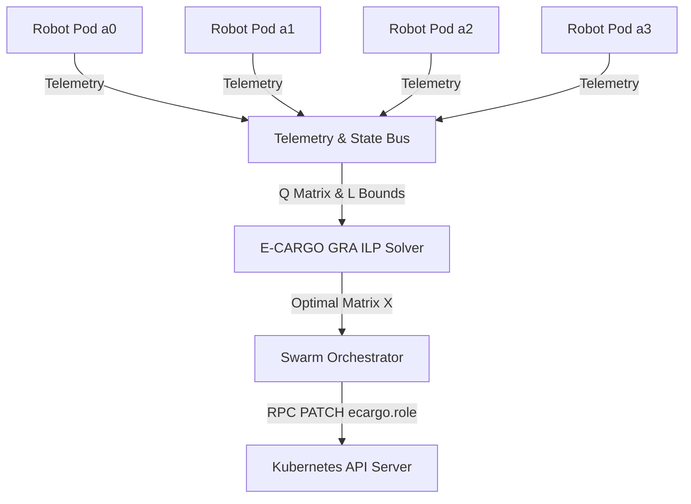

# Unit 3 Architectural & Fundamental System Models (CDK5 Chapter 2)

**Group Members:** `<List Group Members>`  
**Assigned Track:** `<Track 1 / Track 2 / Track 3 / Track 4>`  

---

## 1. Architectural Model (CDK5 Section 2.3)

### 1.1 System Architecture Diagram
> **[GROUP TODO]:** Insert your custom architectural diagram/illustration here (Mermaid diagram, SVG/PNG image in `docs/images/`, or ASCII architecture blueprint) showing:
> - Communicating entities (`robot-a0`..`robot-a3`, Telemetry State Bus, E-CARGO GRA Solver, Kubernetes API Server / `etcd`)
> - Indirect communication (asynchronous telemetry snapshots) vs. direct request-reply RPC (`PATCH` pod metadata)
> - Logical/physical placement across simulated edge agents and centralized Kubernetes control plane

### 1.2 Architectural Analysis
> **[GROUP TODO]:** Provide your analysis covering:
> 1. **Communicating Entities:** Roles and responsibilities of each component.
> 2. **Communication Paradigms:** Contrast indirect communication vs. direct RPC calls.
> 3. **Placement & Reconfiguration Transparency:** Explain how patching `ecargo.role` pod labels achieves dynamic role reassignment without container restarts.

---

## 2. Fundamental Models (CDK5 Section 2.4)

### 2.1 Interaction Model
> **[GROUP TODO]:** Add a sequence/timing diagram and analyze:
> - Synchronous vs. asynchronous communication assumptions in your control loop
> - Network latency bounds between edge robots and the Kubernetes control plane
> - How clock drift/skew affects telemetry freshness and global state snapshots

### 2.2 Failure Model
> **[GROUP TODO]:** Add a fault-propagation and recovery diagram and analyze:
> - Exact failure/degradation mode modeled in your assigned track (omission, partial hardware fault, energy exhaustion, or QoS overload)
> - Contrast **crash-stop failures** (Unit 2 reactive pod deletion) against **graceful role reconfiguration** (Unit 3 preemptive E-CARGO handoff)

### 2.3 Security Model
> **[GROUP TODO]:** Add a trust-boundary and threat-model diagram and analyze:
> - Trust boundaries between field robot pods and the Kubernetes control plane
> - Potential threats (e.g., spoofed telemetry falsifying `Q[i,j]`, unauthorized pod label `PATCH` operations, wireless link tampering)
> - Concrete security defenses (Kubernetes RBAC least-privilege `ServiceAccount`, mTLS API authentication, cryptographic payload signing)
